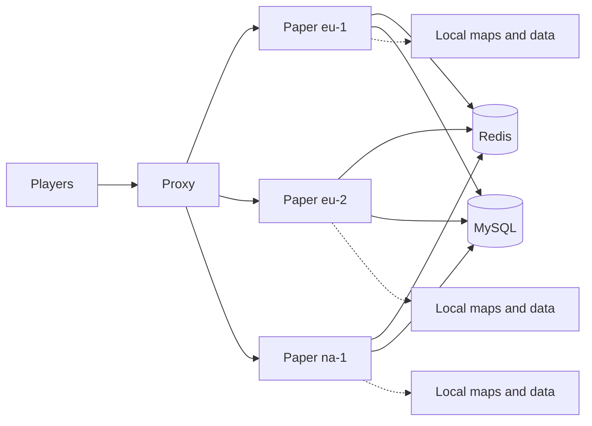

# Vise Core

Vise Core is a Minecraft PvP plugin for **Paper 1.21.3** and **Java 21**. It manages arenas, kits, queues, ranked matches, parties, and events. It also handles the lobby, player profiles, cosmetics, chat, and travel between server instances.

Scale a single instance with schematic slots or Polar world copies, or add Paper instances that share profiles, leaderboards, and chat through MySQL and Redis. [Arena backends](#choosing-an-arena-backend) · [Scaling guide](#scaling-and-deployment-architecture)

<a name="vise-core-vs-strikepractice"></a>

## How Vise Core compares

| Feature | **Vise Core** | StrikePractice | Versus | UltimateDuels | Duels by Realized |
| --- | :---: | :---: | :---: | :---: | :---: |
| Direct 1v1 challenges | ✅ | ✅ | ✅ | ✅ | ✅ |
| Arena kits and spectator mode | ✅ | ✅ | ✅ | ✅ | ✅ |
| Ranked play or Elo ratings | ✅ | ✅ | ❌ | ✅ | ✅ |
| Party fights and public FFA arenas | ✅ | ✅ | ❌ | ✅ | ❌ |
| Personal kit editor and saved layouts | ✅ | ✅ | ❌ | ✅ | ❌ |
| Automatic arena restoration | ✅ | ✅ | ❌ | ✅ | Paid extension |
| PvP practice bots | ✅ | ✅ | ❌ | ❌ | ❌ |
| PolarPaper arena generation from saved origins | ✅¹ | ❌ | ❌ | ❌ | ❌ |
| Built-in HTML telemetry export with movement, health, and ping charts | ✅ | ❌ | ❌ | ❌ | ❌ |
| Redis chat bridge and regional travel menu | ✅ | ❌ | ❌ | ❌ | ❌ |
| Built-in ping-aware knockback and ghost-arrow recovery | ✅ | ❌ | ❌ | ❌ | ❌ |
| Lava Rising survival events | ✅ | ❌ | ❌ | ❌ | ❌ |
| Challonge tournament brackets | ✅ | ❌ | ❌ | ❌ | ❌ |
| PvPTiers, MCTiers, and Subtiers in one profile | ✅ | ❌ | ❌ | ❌ | ❌ |
| **Completely Free** | **✅** | **❌** | **✅** | **✅** | **✅** |

✅ denotes a documented feature of the base plugin. On feature rows, ❌ denotes a capability unlisted in the cited materials. The pricing row covers the base download. ¹ The PolarPaper integration has a version constraint described in the [arena generation guide](#polarpaper-arena-generation-support).

- **StrikePractice** is a paid practice suite with bot fights, replay playback, per-kit knockback configuration, and built-in events. The author's separate stats site can display saved fight data. [Product listing and pricing](https://builtbybit.com/resources/strikepractice-practice-pvp-plugin.74743/) · [v4.0.0 release notes](https://builtbybit.com/resources/strikepractice-practice-pvp-plugin.74743/updates) · [Stats site](https://github.com/toppev/strikepractice-stats)
- **Versus** focuses on casual 1v1 duels for semi-vanilla servers. It documents arena setup, waiting when arenas are full, public and private matches, and in-game configuration editing. [SpigotMC listing](https://www.spigotmc.org/resources/versus-1-16-1-21-%E2%9A%94%EF%B8%8F-duels-simplified.118883/) · [Source and commands](https://github.com/robomonkey-mc/Versus) · [Downloads](https://www.spigotmc.org/resources/versus-1-16-1-21-%E2%9A%94%EF%B8%8F-duels-simplified.118883/history)
- **UltimateDuels** documents multi-round 1v1 and party play, party queues, per-player kit variants, FFA worlds, built-in scoreboards, and WorldEdit or FAWE schematic restoration. [Modrinth listing](https://modrinth.com/plugin/ultimateduels)
- **Duels by Realized** offers item and money wagers, sign-based queues, kit ratings, inventory inspection after matches, and an extension system. Its automatic arena-reset extension is listed separately from the base download. [SpigotMC listing](https://www.spigotmc.org/resources/duels.20171/) · [Author's command reference](https://github.com/Realizedd/Duels/wiki/Commands)

## Contents

- [Installation and module setup](#installation-and-module-setup)
- [Duels, arenas, and matchmaking](#duels-arenas-and-matchmaking)
  - [PolarPaper arena generation support](#polarpaper-arena-generation-support)
- [Ranked play and match reports](#ranked-play-and-match-reports)
- [Experimental NPC practice](#experimental-npc-practice)
- [Kits and inventory layouts](#kits-and-inventory-layouts)
- [Parties, FFA, Lava Rising, and tournaments](#groups-and-events)
- [Lobby, teleportation, and server travel](#lobby-teleportation-and-server-travel)
- [Scaling and deployment architecture](#scaling-and-deployment-architecture)
- [Profiles, statistics, and cosmetics](#profiles-statistics-and-cosmetics)
- [Friends, chat, and Discord](#friends-chat-and-discord)
- [Combat fixes and server operations](#combat-fixes-and-server-operations)
- [Configuration, data, and upgrades](#configuration-data-and-upgrades)
- [Codebase map](#codebase-map)
- [PlaceholderAPI reference](#placeholderapi-reference)
- [Command and permission reference](#command-and-permission-reference)

## Installation and module setup

1. Build with `./gradlew build` on macOS or Linux or `gradlew.bat build` on Windows. Put `build/libs/ViseCore-1.0.0.jar` in Paper's `plugins/` directory. GitHub Actions also publishes the JAR as the **ViseCore** build artifact. [Build workflow](../../actions/workflows/build.yml)
2. Install FastAsyncWorldEdit or WorldEdit if you plan to use Duels or modules that share its arenas and kits.
3. Start Paper once to generate `plugins/Core/config.yml`. Create a MySQL database and configure its connection alongside Redis. The default endpoints point at localhost. Paper may disable Core on the first run until MySQL is reachable and the configured user can create the tables. Restart Paper after configuring both services.
4. Set `lobby_world` to the name of your lobby. Stand at the arrival point and run `/setspawn`. If you use multiple instances, give each one its own `region` and `id_number` combination.
5. Grant the command and feature permissions players need. Create a test kit and arena before opening matchmaking. Set up FFA worlds and event arenas independently of the duel map list.

The Paper plugin ID is `Core`, so its data directory is `plugins/Core/`. Most settings take effect after a Paper restart. Use the shipped defaults as a reference when editing the generated files. [Main configuration](src/main/resources/config.yml)

### Modules and requirements

Set each entry under `modules` to `true` or `false`. The defaults below apply to a fresh install. A module flagged as on can still be skipped if a dependency is missing.

| Module | Default | Purpose and requirements |
| --- | --- | --- |
| `Duels` | On | Direct challenges, queues, ranked matchmaking, spectating, shared kit and arena storage, and optional NPC practice. Requires FastAsyncWorldEdit or WorldEdit at startup. |
| `Party` | On | Parties, challenges between parties, and matches within a party. Uses Duels. |
| `FFA` | On | Persistent free-for-all worlds, teleport spots, and personal FFA layouts. Uses Duels for the base kits. |
| `CustomKit` | On | Personal kit creation, selection, load commands, and sharing codes. |
| `Friends` | On | Friend requests, friend lists, and friend-aware invites and messaging. |
| `LavaRising` | Off | Survival events with a rising lava floor. Uses Duels for schematic loading and needs a configured event world and arena. |
| `CriticalDiscord` | Off | Discord invites and account-linking commands. Linking needs a companion Discord integration that handles Core's codes. |
| `Tournaments` | Off | Challonge brackets played in Minecraft. Requires Party, Duels, a Challonge username, and an API key. |
| `KnockbackSynchronization` | On | Ping-aware adjustments to combat knockback. Also has its own `enabled` setting. |
| `AntiGhostArrow` | On | Arrow hit recovery when players and arrows move between server ticks. Also has its own `enabled` setting. |

The optional PolarPaper backend has its own [version requirements](#polarpaper-arena-generation-support). PlaceholderAPI adds values for compatible tab lists, scoreboards, and chat plugins. FeatherServerAPI loads the optional `plugins/Core/server-background.png` as a server-list background. **XenoWorldReset** powers the `/rtp` random-teleport menu. [XenoWorldReset documentation](https://wiki.bitaspire.com/en/docs/xenoworldreset)

## Duels, arenas, and matchmaking

### Direct challenges and spectating

Run `/duel <player>` to challenge an online player. The setup menus let the challenger pick a ruleset, an arena, and the number of rounds needed to win. The recipient can click **Accept** in chat or run `/acceptduel <challenger>`. A standard ruleset supplies the same base equipment and combat rules to both sides. The **Per Custom Kit** option lets each fighter use their own selected personal kit. Challenge preferences and block lists affect who can send requests. Friends can bypass the invite toggle, while a block still applies.

During the match, Core reserves an arena, equips the fighters, starts a countdown, and tracks round wins. Team matches use the same arena and kit system. Kits can define whether players can build, regenerate health naturally, lose hunger, or expose health indicators. Duel listeners handle damage during countdowns, prevent friendly hits, and resolve lethal hits as round outcomes while allowing totems to trigger. At the end, Core returns participants to the lobby and releases the arena for reuse.

Run `/spectate <player>` to watch an active fight. Spectating respects the player's preference and applies restrictions to keep spectators out of combat. Use `/spawn` to leave. The [PlaceholderAPI expansion](#placeholderapi-reference) supplies team colors, health indicators, score, elapsed time, and spectator information to compatible displays.

#### How a duel runs

| Stage | Server behavior |
| --- | --- |
| Allocation | Core binds participants to a duel and reserves either a position in a schematic world or a Polar world copy. The two team spawn points are resolved in that reservation's world. |
| Countdown | Fighters get their kit, round state, and start feedback. Combat listeners protect the countdown, restrict teammates from damaging one another, and apply kit rules for building, regeneration, and food. |
| Live round | Core checks the X/Z arena bounds each tick. Fighters outside the active bounds are treated as eliminated. Spectators outside the bounds are sent inward. Moving between two Polar copies of the same arena is a supported round transition. |
| Elimination | The lethal-hit listener lets a held totem use vanilla handling. Otherwise it resolves the killer, switches the defeated player to spectator, and informs the duel. The duel updates the team score and can announce the surviving players' health. |
| Reset or finish | A continuing match reapplies kit inventory and effects and resets player positions. On a cross-world round reset, the inventory is applied after the teleport completes. The end-of-match cleanup sends players and spectators back to the lobby and releases arena reservations. |

[Duel state and transitions](src/main/java/org/albi/core/modules/Duels/DuelInstance.java) · [Bounds checks](src/main/java/org/albi/core/modules/Duels/events/MovementOutside.java) · [Lethal-hit handling](src/main/java/org/albi/core/modules/Duels/events/OnSimulatedDeath.java)

### Casual queues

`/queue` opens a kit browser with queue counts. Choose a standard kit or **Per Custom Kit**. `/quickqueue` looks for a match in an active casual queue without making the player choose a specific ruleset. The action bar shows queue status while the player waits. Run `/queue leave` or `/quickqueue leave` to leave the casual queue.

The casual matcher checks every two ticks and tries the quick queue first. Two quick-queue players can receive a random standard kit. A lone quick-queue player can take a match from another eligible queue, including Per Custom Kit when both players have usable selections. Regular kit queues pair eligible players waiting for the same kit. Casual matches start first-to-one and pick from active arenas. The match-found transition rechecks player state before starting the duel. [Casual matchmaking code](src/main/java/org/albi/core/modules/Duels/queue/DuelQueueModule.java)

Staff can organize the duel and casual queue browsers into ruleset pages. Hold the item to use as the category icon, then run `/setpageduelkitcategory <page> <guiSlot>`. Use `/deletepageduelkitcategory <guiSlot>` to remove that entry from the category menu.

### Choosing an arena backend

| | Schematic arenas | PolarPaper arena generation |
| --- | --- | --- |
| **Hardware fit** | **Lower RAM, stronger CPU.** Start here when memory is scarce and the server can keep up with repeated pastes. | **Higher RAM, less CPU headroom.** Use ready-to-play world copies to reduce repeated block pastes during matches. |
| Unit of capacity | A reserved grid slot inside the loaded `<arena>-duel` world. | A separate loaded copy of an arena's saved Polar origin. |
| How the map is reset | Paste blocks and air back into the slot through WorldEdit or FAWE. | Use a fresh world copy and retire the used world after players leave. |
| Main capacity control | `setmax <name> maxarenas <count>` sets the number of slots for that map. `perline` and the X and Z offsets lay them out. | `polar_preload` sets the minimum ready-pool target per map. The target also grows with reservations. |
| Resource costs | Clipboard cache, loaded chunks, block edits, and a shared paste queue. | Cached origin bytes, decoded and loaded world copies, startup and refill work, and cleanup of retired worlds. |

This is a hardware rule of thumb. A big clipboard still takes memory, and generating a Polar copy still takes CPU. Arena size, how often build kits need resets, and how many matches run at once determine which backend fits. [Capacity and load testing](#scaling-and-deployment-architecture) · [PolarPaper's memory tradeoff](https://github.com/MinehubMC/PolarPaper#large-worlds)

### Schematic arenas

The schematic backend gives multiple matches separate physical slots inside one loaded world per arena name. Core lays out slots from `(0, 100, 0)` in that world. For a zero-based slot index, the row is `index / perline` and the column is `index % perline`. The row advances along X and the column advances along Z using the configured offsets. Team spawn coordinates are added to the slot's paste origin, so record them relative to the schematic origin in your build area. The X/Z arena bounds move with the copy.

1. Prepare a clean template in `plugins/Core/duel-placeholder/` and put the arena schematic in `plugins/Core/schems/duels/`. Export the schematic with a known origin and record spawn and boundary offsets relative to that point.
2. Run `/dueladmin arena create <name>` and then `/dueladmin arena arenaready <name>`. The second command copies the template to `plugins/Core/<name>-duel/` and replaces an existing copy at that path. Make the arena world available through your world setup and verify that Paper has loaded it with the exact name `<name>-duel`. The match allocator looks up that loaded world by name.
3. Hold a map icon and run `/dueladmin arena setdisplayitem <name>`. Stand at each team spawn in the origin-aligned build area and use `/dueladmin arena setspawn <name> 1` and `/dueladmin arena setspawn <name> 2`. Core saves the position and facing direction.
4. Record the relative horizontal boundaries with `/dueladmin arena setcorner <name> <x1|z1|x2|z2> <coordinate>`. Link the map with `/dueladmin arena setschematic <name> <file>`.
5. Set a positive `perline` and `maxarenas` with `/dueladmin arena setmax <name> <perline|maxarenas> <count>`. Set X and Z spacing with `/dueladmin arena setoffset <name> <x|z> <blocks>`. Leave space between copies for the full playable footprint and the arena buffers. Use `/dueladmin arena info <name>` to inspect the settings and `/dueladmin arena deactivate <name>` to toggle selection in the direct duel and casual arena pickers.
6. Test two simultaneous matches on the same map before adding capacity. Check that their spawn points and bounds are separate. Play a build round, break and place blocks, and check that the following round and the next match get the expected layout.

Core caches decoded clipboards by filename within the process and runs one queued schematic paste at a time. The paste runs through a WorldEdit edit session on an asynchronous task. The queue schedules a five-tick gap after each paste. Duel launch and build-round reset can enqueue paste work, and a freed slot becomes eligible for reuse. A large map or multiple reset requests can delay other arenas using the same paste queue, including Lava Rising work. Keep distinct filenames for different maps and restart the instance after replacing a schematic in place so a cached clipboard is reloaded. [Schematic queue](src/main/java/org/albi/core/modules/Duels/SchematicManager.java) · [Duel allocation and lifecycle](src/main/java/org/albi/core/modules/Duels/DuelInstance.java) · [Arena setup commands](src/main/java/org/albi/core/modules/Duels/commands/DuelAdminCommand.java)

<a name="polar-arenas"></a>

### PolarPaper arena generation support

Core can generate isolated match worlds from a saved **PolarPaper** origin. Map builders work in one editable origin and publish it with a save command. At runtime, Core creates uniquely named match worlds from that saved version. Every copy starts from the same map coordinates.

> [!IMPORTANT]
> Core's build targets Paper 1.21.3 and compiles the Polar integration against `live.minehub:polarpaper:1.21.11.17`. That dependency JAR declares Paper API 1.21.11. PolarPaper's historical 1.1.3 release for Paper 1.21.3 uses older load and save signatures and lacks the `FilePolarSource` class Core uses. Use schematic arenas on the documented Paper 1.21.3 setup. Validate the full Core, Paper, and PolarPaper combination on staging before turning on the optional backend. [Build dependency](build.gradle.kts) · [PolarPaper versions](https://hangar.papermc.io/MinehubMC/Polar/versions) · [Historical Paper 1.21.3 release](https://hangar.papermc.io/MinehubMC/Polar/versions/1.1.3)

On a compatible setup, install PolarPaper, enable Duels, and restart Paper with the following settings.

```yaml
use_polar_worlds: true
polar_preload: 2
```

| Step | Action |
| --- | --- |
| Create the origin | Run `/dueladmin polar_arena create <name>`. When the origin file is absent, Core creates a temporary flat world without structures, converts its blocks to Polar, writes the origin, and cleans up the bootstrap world. The command opens the origin for the builder. |
| Edit the map | Run `/dueladmin polar_arena edit <name>` to reopen the loaded origin or load it from disk. Build or paste your intended map into that world. |
| Record teams | Stand at each spawn and use `/dueladmin polar_arena spawn1 <name>` and `spawn2 <name>`. The equivalent command is `/dueladmin polar_arena setspawn <name> <1\|2>`. The editor records exact X/Y/Z and yaw/pitch. |
| Record bounds and icon | At the two opposing corners run `/dueladmin polar_arena set_limit <name> min` and `set_limit <name> max`. These commands record X/Z limits. Hold an item for `/dueladmin polar_arena setdisplayitem <name>`. |
| Publish it to the ready pool | Run `/dueladmin polar_arena save <name>` or `/dueladmin polar_arena arenaready <name>` with the origin loaded. Run `/dueladmin polar_arena info <name>` to review the setup. |

#### What happens during a match

1. **Origin storage.** Arena definitions, team positions, and the Polar flag are in Core's local data. The actual map is `worlds/<lowercase-arena>-p-orig.polar` inside the PolarPaper plugin's data directory. Back up both when moving or restoring a server.
2. **World creation and reservation.** The arena manager caches origin bytes, decodes a copy for each new match world, and tracks ready worlds and in-use reservations separately by arena. Generated names follow `<arena>-p-<sequence>-<suffix>-duel`. Copies enable keep-inventory and immediate respawn. The arena lookup uses the recorded positions in the selected copy.
3. **Consumers.** Casual and ranked duels, party team fights, and tournament duels can use the normal duel allocator. NPC practice and private Party FFA sessions also reserve Polar copies when their chosen arena uses Polar. Public FFA and Lava Rising have their own world workflows.
4. **Round resets.** Build and per-custom duel paths can reserve a replacement copy for the next round. When a replacement is ready, the duel switches worlds and reapplies the players' kit after teleporting. A replacement reservation contributes to the active reservation count. [Duel lifecycle](src/main/java/org/albi/core/modules/Duels/DuelInstance.java) · [NPC session](src/main/java/org/albi/core/modules/Duels/AutomatedCombat/BotSession.java) · [Party FFA allocation](src/main/java/org/albi/core/modules/Party/play/PartyFFAInstance.java)
5. **Retirement and edits.** At release, Core schedules temporary-world unload and attempts to remove the generated world folder. If players are still there, it schedules a retry after 100 ticks. Saving a new origin refreshes the byte cache and retires unused copies from the older origin. Active fights keep the worlds they already reserved.
6. **Maintenance.** The instance warms saved arenas at startup. Join, quit, and world-change events schedule maintenance that looks for missing reserved worlds and queues replenishment. Background Polar operations go through a serialized queue. Its current delay between completed tasks is 250 ticks. The immediate startup and reservation paths can also generate worlds synchronously from Core's perspective by waiting on the world creation future.

The effective ready target is `max(max(1, polar_preload), active reservations + 1)` **per arena**. With the default preload and three in-use reservations on one map, Core aims for four ready copies in addition to those three. That means seven loaded match worlds at the target, before counting an open origin or a world waiting for cleanup. `polar_preload` is a floor for ready capacity. Budget RAM for the active and ready worlds together, and profile both a cold launch and the first reservation burst. [Polar arena manager](src/main/java/org/albi/core/modules/Duels/polar/PolarArenaManager.java) · [World operation queue](src/main/java/org/albi/core/modules/Duels/polar/PolarQueue.java) · [Maintenance listener](src/main/java/org/albi/core/modules/Duels/events/PolarArenaMaintenanceListener.java)

## Ranked play and match reports

`/rankedqueue` opens solo, single-round matchmaking by standard kit. The menu shows the player's Elo, placement or tier, and the number of players waiting for each kit. The queue widens its Elo search range as players wait. Leaving a party and ending any active fight or spectating session makes a player eligible to queue. Use `/rankedqueue leave` to cancel.

- Each kit has its own rating, win and loss counts, and placements. Core also tracks an overall rating. Ratings start at **1,000 Elo**. The first **five matches** count as placements by default. The Elo adjustment uses a factor of 64 during placements and 32 after.
- The initial search window is ±50 Elo. It grows by 25 for every three seconds waiting. A pair is eligible if the gap fits either player's current window. Wins against higher-rated opponents are worth more, and the match countdown previews the stakes.
- Tiers run from Bronze through Silver, Gold, Platinum, Diamond, Master, Grandmaster, and Champion. Each tier has five 100-point divisions. Players see placement progress until they earn a displayed tier.
- `/rankedlb` opens the top 27 by overall ranked Elo in Redis. The kit picker and match calculations use the selected kit's ladder. For an arena pool specific to a kit, use `/rankedadmin add <kit> <arena>`, `remove <kit> <arena>`, and `list <kit>`. If the pool is empty, the queue draws from the shared arena list. Staff can access the pool commands with both `core.rankedadmin` and `core.admin.ranked`.

[Ranked matcher](src/main/java/org/albi/core/modules/Duels/queue/RankedQueueModule.java) · [Elo calculation](src/main/java/org/albi/core/modules/Duels/ranked/EloCalculator.java) · [Leaderboard reader](src/main/java/org/albi/core/modules/Duels/ranked/RankedCommands.java)

### Match telemetry, history, and export

Ranked duels record telemetry. In a direct challenge, the challenger can also enable **Match Telemetry** for a first-to-one, first-to-two, or first-to-three match. For eligible multi-round duels, Core starts a fresh record each round. Each record gets an eight-character ID.

- Hit events capture attacker, distance, aim angles, and vertical separation. The distance calculation uses the player's eye ray against the target hitbox, with nearest-box distance as a fallback. Core also counts arm swings, total damage, and longest combos.
- A repeating task samples both players' positions, health, and ping every 20 ticks. A second sampler collects ping every 100 ticks. The HTML report combines the event stream and periodic snapshots into charts for movement, health, reach, hit frequency, and network conditions.
- The current record can flag unusual measured reach for review. It is a telemetry signal. Consult the recorded context before treating a flag as evidence of a rule violation.
- On the normal round-end path, the telemetry record closes before the ranked result update. A saved report can show an unset winner or Elo deltas even though the ranked profiles have been updated.

[Match tracker](src/main/java/org/albi/core/modules/Duels/ranked/MatchTracker.java) · [Match record](src/main/java/org/albi/core/modules/Duels/ranked/RankedMatchRecord.java) · [HTML report generator](src/main/java/org/albi/core/modules/Duels/ranked/RankedReportGenerator.java)

| Command or setting | What it does |
| --- | --- |
| `/seegames [player]` | Queries MySQL for up to ten recent records for yourself or the named online player. |
| `/matchinfo <match_id>` | Reads a stored match and displays the kit, participants, average measured reach, and any recorded review flag. |
| `/rankedreport <match_id>` | Generates an HTML report under `plugins/Core/reports/`. It includes charts and a match timeline for reviewing health, movement, reach measurements, combos, and network conditions. Charts use a browser-loaded library. |
| `ranked.history_expiry_days` | Sets the Redis report cache lifetime and the age at which older SQL matches are pruned on startup. Defaults to seven days. |
| `ranked.webhook_url` | Sends match summaries and permits HTML report export to a configured webhook. `VISE_RANKED_WEBHOOK_URL` overrides the YAML value. |
| `ranked.report_url_template` | Adds a clickable report URL to the match ID message. Set a URL on your own report host with `{match_id}` in the appropriate place. Core saves reports to disk and the external host serves the link. |

## Experimental NPC practice

> [!WARNING]
> NPC practice uses version-specific Paper server internals. Updates can break NPC spawning, combat, or cleanup. Test a full practice duel and arena reuse on a staging server before enabling this feature or upgrading Paper.

Enable `duels.bots.enabled` and grant `core.automatecombat` to players who should use `/automatecombat`. An active duel arena and a playable kit are required. The NPC shares the duel arena system but has its own practice session, round score, and health display.

- The practice menu lets players choose a map, kit, and available preset. Built-in preset families cover **Beast**, **Pot**, **SMP**, and **Netherite OP**. The bundled public-kit allowlist contains `beast` and `pot`. Adjust `duels.bots.allowed_kits` to match the public kit IDs on your server.
- Advanced settings cover sprint-hit frequency, W-taps, attack range, strafing, movement and retreat speeds, reaction delay, chase distance, shield use and shield breaking, and resynchronization distance. Players can change the round target. Invulnerability lets players practice hits and knockback while both sides keep their health.
- `duels.bots.max_sessions` caps simultaneous practice duels, `default_rounds` sets the initial round target, and `debug_logging` enables bot diagnostics. The command, server log, and practice UI identify the feature as experimental.

Core creates a server-side fake player and equips it from the selected kit. Its tick loop manages aim, spacing, sprint resets, shields, and supported potions based on session state and inventory. The practice listener connects damage, projectiles, and departures to the correct session. Eligible rounds can reserve a fresh Polar copy. On normal close, Core cancels the session tasks, removes the NPC, and releases the arena. The bot's own round scoring stays inside the practice session. [NPC lifecycle](src/main/java/org/albi/core/modules/Duels/AutomatedCombat/FakePlayerNPC.java) · [Practice session](src/main/java/org/albi/core/modules/Duels/AutomatedCombat/BotSession.java)

## Kits and inventory layouts

### Shared rulesets

Use `/dueladmin kit create <name>` to register a public kit. Set up your inventory and run `saveinv <name>` under `/dueladmin kit`. Use `setdisplayitem <name>` while holding the GUI icon and `setslot <name> <slot>` to place it in the kit browser. `info <name>` shows the rules, `list` shows the available kits, `give <name>` equips the kit for inspection, and `delete <name>` removes it.

The `setbuild`, `setnaturalregen`, `sethealthindics`, and `setlosehunger` subcommands each take a kit name and a boolean. `/kiteditor` opens a chooser for duel layouts, FFA layouts, and the personal-kit browser. A saved layout changes the equipment arrangement for that player. Public kit names, arena configuration, and a player's saved layout are separate pieces of data.

`/setkitdata <kit> <type> <key> <value>` edits typed kit metadata. The type can be `STRING`, `INT`, `DOUBLE`, `BOOLEAN`, `LONG`, or `EFFECTMETA`. The keys below affect gameplay.

| Kit metadata | Behavior |
| --- | --- |
| `dmg_inc_%` | Positive integer percentage increase on qualifying player hits. A match in the legacy `33_percent_boost` configuration list sets the increase to 33%. |
| `mending_rng` | A positive integer overrides the amount an individual Mending event repairs. This is a repair amount. |
| `tnt_ignite` | Boolean that makes placed TNT ignite automatically in supported duels. The fuse uses `duels.tnt_seconds`. |
| `effects` | Potion effects applied when the kit is equipped in a match. `EFFECTMETA` appends an effect using `EFFECT:AMPLIFIER:DURATION:AMBIENT`, such as `SPEED:1:60:false`. Duration is in seconds. |

### Personal kits

`/customkit` opens a grid of **36** personal kit slots. Create a kit in an empty slot, select an existing kit for Per Custom Kit matches, or click the selected slot to edit it. `/k1` through `/k36` equip the corresponding saved kit directly. Each load command resets the current inventory and equips the saved gear.

- **Equipment and item editing.** Edit armor, offhand, hotbar, and inventory slots. Choose items from staff-curated categories. Item actions include changing names, enchantments, and stack sizes, removing items, and editing items inside shulker boxes and a kit's ender chest.
- **Direct Kit Room.** Edit the inventory directly and explicitly save it back to the kit. The room provides a clear-inventory action and a trash slot for unwanted items.
- **Kit settings.** Change build, hunger, regeneration, and health-indicator rules where offered by the menu. The kit editor also supports potion effects, a Mending repair override, a damage increase setting, and automatic TNT ignition.
- **Sharing.** Use **Share Kit** to generate a Redis-backed code. Codes are valid for 30 days from the latest share. Another player can run `/copykit <code>` and pick an empty slot for a copy.
- **Category administration.** Hold a display item and run `/createcustomkitcategory <name> <guiSlot>`. Use `/setitemincustomkitcategory <name> <guiSlot>` to place the held item inside the category. Use `/changecategorylogo <name>` to replace the display icon, `/categorylist` to inspect categories, and `/deletecustomkitcategory <name>` to remove one.

## Groups and events

### Parties

A party is a leader-managed group for inviting players and starting team matches. Create one with `/party create`, invite an online player with `/party invite <player>`, and accept with `/party accept`. Use `/party list` to check the roster, `/party leave` to leave, and `/party disband` to close the group as its leader. The default capacity is four. Grant a leader a larger `core.party.size.<number>` to raise the cap when their party is created.

- **Public parties.** `/party open` toggles whether other players can join without an invite. Opening requires `core.openparty`. Players use `/party join <leader>` or click the broadcast. Reopening a recently closed party has a one-minute cooldown that `core.openparty_cooldownbypass` can bypass.
- **Party settings.** `/party settings` lets the leader configure shuffle and auto-balance for drafting teams. Parties have their own lobby shortcuts for managing the group and opening play.
- **Party challenges.** `/party duel <leader>` opens a challenge to another party. The setup picks the ruleset and arena. The other leader can accept with the clickable invite or `/partyduelaccept <leader>`.
- **Intra-party matches.** `/party play` lets a party draft teams for a fight within the group. Choose balanced or asymmetric sizes, including custom sizes such as `2v5`. Select a shared ruleset, a selected custom kit, or per-player custom kits where available.
- **Party FFA.** The party play menu also offers a private free-for-all in a duel arena for two or more online party members. It tracks kills, remaining players, and elapsed time. This mode uses the party's match session. The public FFA worlds have their own entry and respawn flow.

### Public FFA worlds

`/ffa` opens an arena selector organized by kit and then by the world's saved entry spots. FFA worlds use a public kit as their base ruleset and can apply a player's saved FFA layout when they enter or rekit. On death, the player returns to the lobby and can use a **Teleport Back** feather to return to their last FFA location. FFA kill messages go to the arena and the lobby. FFA placeholders expose saved per-kit kills, deaths, streak, and kill-to-death ratio. The arena death handler increments the death counter and reapplies the surviving player’s kit when applicable.

Set up each FFA world with these steps.

1. Create the base kit under `/dueladmin kit` and load the FFA world in Paper. Include the exact world name in `ffa_worlds` so FFA listeners and placeholders recognize it.
2. Run `/ffaadmin kit create <kit>` to create an FFA profile and copy the base kit's flags, then `/ffaadmin setupworld <kit> <world>` to associate the profile with the world.
3. Stand at an entry point in the linked world, hold the icon, and run `/ffaadmin world teleport <slot>` to save that location in the selector. Use slots `0` through `8` for the spot menu.
4. Use `/ffakiteditor` or the FFA option in `/kiteditor` to rearrange a personal layout for that kit. The base profile controls building, regeneration, hunger, and health indicators.

### Lava Rising

Lava Rising is a survival event in a configured world and a bounded schematic arena. Players enter with `/lavaspawn` or `/event`. The lobby counts entrants, announces that players can join, and starts a countdown once the configured minimum is reached. If players leave and the count drops below the minimum, the countdown cancels. A late arrival during an active match enters as a spectator above the arena.

Players begin with the configured starter items. The match initially keeps PvP off and enables it later. Lava rises one level at a time inside the arena, the game checks who is still alive, and the last survivor can win before the time limit. An optional webhook announces the approaching start and match start.

| Setting or command | Purpose |
| --- | --- |
| `lava_rising.lava_rising_world` | Loaded Paper world used for the event lobby and match. |
| `/lavasetspawn` | Saves the waiting area players arrive at. Stand in the event world when setting it. |
| `/lavaarena create <name>` | Creates a record for an event arena. Use `list` to inspect recorded arenas or `delete <name>` to remove one. |
| `/lavaarena setspawn <name>` | Records the in-arena starting position. |
| `/lavaarena setschematic <name> <file>` | Selects a schematic from `plugins/Core/schems/lavarising/`. |
| `/lavaarena setpos1 <name>`, `/lavaarena setpos2 <name>` | Record the two arena corners used for bounds and the lava fill. |
| `/lavaforcestart` | Starts an event manually after the world and arena are ready. |
| `pregame.required_players`, `lobby_wait_seconds`, `reminder_interval_seconds` | Control the population threshold and timing for the pregame countdown. These keys are under `lava_rising.pregame`. |
| `pregame.spectate_height` | Vertical offset for late-join spectators, relative to the arena spawn. |
| `time_lava_start`, `time_lava_rise`, `time_pvp`, `time_finish` | Seconds until lava starts, seconds between rises, seconds until PvP, and the event time limit. |
| `starter_items` | Inventory at match start. Entries can use `MATERIAL` or `MATERIAL:COUNT`. |
| `webhook_url`, `webhook_warn_seconds` | Optional delivery endpoint and the countdown point at which the warning is sent. |

### Challonge tournaments

With `Tournaments` enabled and valid Challonge credentials, Core runs **single-elimination** brackets. A staff member with `core.tournament` and `core.tournament.admin` uses `/tournament create` to select a kit and choose **1v1**, **2v2**, or **3v3**. `/tournament join` signs up an individual or the party of a leader, subject to the event's team size. `/tournament leave` withdraws an entrant. During registration, a leader can withdraw their whole party.

`/tournament start` forms the teams and starts the bracket. Core checks Challonge for open matches, runs them in duel arenas, and sends results back to advance the bracket. Participating players get tournament-specific lobby shortcuts. `/next` moves the player to spectate another active tournament match when one is available. Keep a usable kit and duel arena available for the bracket.

## Lobby, teleportation, and server travel

### Lobby spawn and protection

- **Player arrival and shortcuts.** `/setspawn` stores a location. `/spawn` returns players there. Lobby hotbar items expose travel, the kit editor, queues, party actions, statistics, and settings as applicable. Active queues and tournaments can replace normal shortcut items with controls for the current activity.
- **Command items and destinations.** Hold an item and run `/setspawnitem <slot> <command…>` to store a command-bound spawn item. Hold a display item at a destination and run `/setgoto <slot>` to save a location in the `/goto` menu. `/store` displays a clickable store link when `network.store_url` is set.
- **Protected lobby.** Core restricts block placement and breaking, item pickup and drops, and interactions in the configured lobby. The Duels module also protects lobby players from combat damage. `/bypass` toggles bypass state for supported restrictions, subject to permissions. A vertical move above `lobby_max_height` returns the player to spawn.
- **Visibility and movement.** Use `/lobbyplayers on` to show other lobby players and `/lobbyplayers off` to hide them. Players with the relevant permissions can use lobby speed, jump boost, or elytra. Lobby elytra can include wind charges for movement. Supported inventory menus play different sounds for actions such as selecting, editing, or backing out.
- **Staff controls.** `/fly` toggles flight. `/gmc`, `/gms`, `/gma`, and `/gmsp` set the game mode for the sender or a named online player. `/vanish` hides a player from viewers without `core.vanish.see`. `/rules` shows the text in `lang.rules`.

### Teleport requests and RTP worlds

`/tpa <player>` asks to go to that player. `/tpahere <player>` asks them to come to you. The recipient has **30 seconds** to run `/tpaccept <requester>` or use the clickable request.

`/rtp` opens a selector for **Plains**, **Snowy**, **Desert**, **Badlands**, and **Mushroom**. Vise Core passes the selected world and player to **XenoWorldReset** by running `xwr rtp <world> <player>` as console. Use a XenoWorldReset build that accepts this command and configure the destination worlds in its `worlds.yml`. [Vise Core menu source](src/main/java/org/albi/core/commands/RTPCommand.java) · [XenoWorldReset world configuration](https://wiki.bitaspire.com/en/docs/xenoworldreset/configuration-files/worlds)

Use Vise Core's `c_worlds` list for world-local death announcements, return to the lobby on respawn, and the one-use `/back` teleport to the last death location in those worlds. With Duels enabled, combat listeners also handle behaviors such as explosive beds there.

### Travel and health across instances

Core writes a heartbeat to Redis every five seconds of server ticks. `/travel` uses those heartbeats to display same-region instances with a player count and online or offline status. A heartbeat older than ten seconds is considered offline. Register the matching instance IDs with a BungeeCord-compatible proxy so the menu can send players to those instances.

For direct region transfers, add entries under `network.travel.regions`. Each entry is keyed by the destination's `region`. The menu shows its display name, optional location and head texture, and the online player count known to Redis. The client transfers to the configured host and port.

```yaml
network:
  travel:
    regions:
      NA:
        name: "North America"
        location: "Toronto"
        host: "na.example.net"
        port: 25565
        texture_url: ""
```

`/health <server>` reads the latest heartbeat for an instance such as `eu-1`. It displays status, last heartbeat, player counts, TPS, uptime, memory, and host information. The Redis health stream also records world, JVM, and server metrics for external monitoring. Keep `core.health` with roles that should see server diagnostics.

## Scaling and deployment architecture

Vise Core runs the lobby, queues, arenas, and combat inside each Paper process. You can **scale up** by giving a busy instance more CPU, RAM, or storage throughput and choosing the arena backend that fits. You can **scale out** by putting multiple Vise Core instances behind a proxy and sharing MySQL and Redis. Adding instances increases the number of places that can host matches. Each queue still matches players on its own instance.

### Vertical scaling on one Paper instance

Start with the resource that limits the actual workload.

| Resource | What drives it in Vise Core | What to change or measure |
| --- | --- | --- |
| CPU and tick time | Combat and entity processing, busy chunks, frequent schematic resets, Polar creation on the reservation path, and NPC activity. The ranked matcher compares waiting players in pairs per kit until it finds compatible opponents. | Put CPU headroom where the Paper tick thread and worker tasks need it. Look at tick-time percentiles during match starts and round resets. Keep the map footprint and loaded chunks modest before increasing concurrent capacity. |
| RAM and garbage collection | Loaded world chunks, the schematic clipboard cache, online profile objects, active match telemetry, and Polar origins and copies. One Polar map can hold several ready and reserved worlds at the same time. | For **high RAM and lower CPU headroom**, choose Polar on a compatible setup where ready copies avoid repeated pastes. For **low RAM and stronger CPU**, choose schematic slots. Check loaded worlds and heap after peak sessions drain as well as during warmup. |
| Local storage | Startup world loads, first-time schematic reads, Polar origin saves and temporary world cleanup, `data.dat`, and report exports. | Give world and report files enough space. Profile cold and warm runs separately. When an arena has trouble cleaning up, check which runtime worlds remain loaded before moving any files. |
| MySQL connections | Each Paper instance owns its own HikariCP pool. `mysql.pool_size` defaults to 20. Startup table work, profile misses and saves, and report history queries use it. | Count connection budgets across all processes. Four instances at the default can open up to 80 pooled MySQL connections in total, before other services. Increase the pool only if connection waits are the bottleneck and MySQL has capacity. |
| Redis connections and response time | The Jedis pool is capped at 16 connections per instance in the current code. Profile caching, leaderboards, travel discovery, health streams, sharing, and linking use Redis. Global chat holds a subscription open. | Measure Redis latency and pool pressure along with Paper tick time. Run backends close to the game servers where possible. Watch shared-service load when adding instances. |

#### Capacity controls

- **Schematic slots.** `maxarenas` caps the addressable slots for one named map on the current instance. Plan X/Z spacing and set `perline` before raising the cap. More slots let more matches reserve that map, but schematic work still passes through one shared paste queue.
- **Polar ready pool.** Start with a small `polar_preload` on each supported test instance. Both active reservations and ready copies are loaded worlds, and demand can raise the target above the configured minimum. An open origin, a reserved next round, and deferred cleanup all affect memory.
- **NPC practice.** `duels.bots.max_sessions` is an instance-wide cap. A session has its own combat loop and consumes arena capacity. Test NPC practice separately from player-only fights so its effect on tick time is visible.
- **Modules and worlds.** Disable features you do not use on that instance. An FFA-heavy server, a duel-focused server, and an event server can use different module and world configurations while their network features share backends. Enable Duels where another module needs its arena or kit storage. Paper's `view-distance` and `simulation-distance` affect chunk and entity work. [Paper server properties](https://docs.papermc.io/paper/reference/server-properties/)
- **Profile flushes.** `storage.flush_interval_seconds` controls the cadence of asynchronous dirty-profile sweeps. A shorter interval asks the backing services to persist changes more often. Budget that load alongside disconnect saves and other activity.

#### Load test the work that actually spikes

1. Measure a quiet baseline after startup. Record server tick time, used and committed heap, GC activity, loaded worlds and chunks, and backend latency.
2. Start simultaneous matches in one popular arena. Include a build kit that forces resets, spectators, and the next match on the same map. For Polar, test the first wave of reservations and the refill after the burst.
3. Add a separate run with peak NPC usage, FFA, or the event you expect to run alongside duels. Capture both steady-state play and transitions such as mass joins, round changes, world retirement, and profile flushes.
4. Change one setting, compare the measurements, and repeat. Use Paper's bundled spark profiler while the load is occurring. `/spark profiler start --timeout 600` captures a ten-minute profile. Watch MSPT as well as TPS so short stalls are visible. [Paper profiling guide](https://docs.papermc.io/paper/profiling/)

### Horizontal scaling across a network



Each instance has a unique `region` and `id_number`. Configure proxy entries with the lowercase names Core publishes, such as `eu-1` and `eu-2`. Same-region travel sends the proxy a `BungeeCord` channel `Connect` message. A regional button uses the client transfer API with the configured host and port. The menu shows stored heartbeats and player counts. Players or your proxy configuration choose where sessions start. [Travel implementation](src/main/java/org/albi/core/commands/TravelCommand.java)

| Shared by configured instances | Owned by each instance |
| --- | --- |
| Player profile and statistics rows, ranked match records, completed Discord links, Redis profile caches and leaderboards, shared-kit codes, Redis chat, and health discovery. | Loaded worlds and map assets, public kit and arena definitions, event setup, spawn and menu locations, and the active matchmaking queues, parties, duels, tournaments, and reservations. |

- **Place players where they can match.** Two players using the same kit on different servers are in different queues. Use travel or proxy routing to bring them to the same instance. Plan where new players go if one practice server has the busiest ladder.
- **Provision local content on each instance.** Deploy the intended kit and arena definitions plus the matching schematic or Polar files to each match host. For Polar, the origin file and Core's accompanying arena definition belong together. Set lobby and event locations for each local world setup.
- **Share backends deliberately.** MySQL stores durable rows and Redis is the live cache and messaging layer. Player keys and the `chat:global` channel are common to the deployment, so keep unrelated environments such as staging and production on separate services where they need isolation.
- **Allow for persistence timing.** Profiles are cached by UUID in each process. Periodic saves and disconnect saves publish and upsert dirty JSON. Transfers are new joins on the destination, so plan for one active session per UUID and let pending saves settle when testing rapid transfers.
- **Plan restarts per instance.** Active matches and queues live in memory. When rolling out changes, move players to another instance or allow matches to finish first. A shared SQL or Redis backend still needs its own availability and backup plan. [Profile and stats storage](src/main/java/org/albi/core/data/StatManagement.java)

### Heartbeats, health streams, and diagnosis

`StatRecorder` takes a snapshot every **100 ticks**, about five seconds at 20 TPS. It gathers Paper state on the tick thread and pipelines a Redis hash update and stream append from an asynchronous task. Each instance writes to `server:<id>:health:latest` and `server:<id>:health:stream`. The stream targets roughly **17,280 entries**, about one day of samples at the nominal cadence. Slower tick rates change the wall-clock interval.

The latest hash includes the timestamp, player count and cap, TPS over several windows, loaded chunks and players per world, JVM memory, uptime, threads, garbage collection, system architecture, and server version. `/health <server>` prints a subset in-game. For fleet monitoring, get the latest hash or sample the stream directly using your normal Redis connection settings.

```sh
redis-cli HGETALL server:eu-1:health:latest
redis-cli XREVRANGE server:eu-1:health:stream + - COUNT 5
```

The travel refresh uses Redis `SCAN` and rebuilds its menu snapshot every 100 ticks. A last heartbeat at least ten seconds old is treated as offline, so check the Paper tick rate and Redis connection as well as process uptime when a server disappears from the available destinations. Region totals use the online instances in the latest travel snapshot. [Health recorder](src/main/java/org/albi/core/data/StatRecorder.java) · [Travel and discovery](src/main/java/org/albi/core/commands/TravelCommand.java) · [Health command](src/main/java/org/albi/core/commands/HealthCommand.java)

## Profiles, statistics, and cosmetics

### Profiles and progression

`/profile [player]` shows account status, level, XP progress, total playtime, a social summary, and a link to detailed stats. Duels can award profile XP, and time spent on a server is tracked separately from time in a ruleset. The profile can also show ranks by game mode, region, and peak rank where returned by **PvPTiers**, **MCTiers**, and **Subtiers**. These providers are queried by player UUID and can independently return unavailable results.

`/stats [player]` opens paged statistics for applicable kit and team-size combinations. The UI displays stored results such as wins, kills, deaths, streak, time, and other activity information when present. `/leaderboard` gives a separate view by stat, kit, and team size. It also accepts `/leaderboard <field> <game>` for a text result. `/rankedlb` shows competitive Elo standings.

Players can limit their profile and stats visibility in `/settings`. Staff with `core.profile.bypass` can open otherwise private profiles.

### Armor trims, kill effects, and particles

- **Armor trims.** `/armortrim` selects a trim independently for helmet, chestplate, leggings, and boots. There are 18 preset pattern-and-material combinations. The menu shows available and locked options, and lets players clear their selections. The saved choices are applied to supported kit armor. Use `core.armortrim.<combo>` or `core.armortrim.*` for unlocks.
- **Kill effects.** `/deatheffects` selects a particle and sound effect that plays on supported kills. The catalog includes Supernova, Black Hole, Angel Wings, and other effects. Players can reset the selection. Grant `core.deatheffect.<effect>` or `core.deatheffect.*` for unlocks. Viewers can mute the effects through their own settings.
- **Ranked particles.** Ranked kits can show tier-colored hit particles during competitive fights. Each player controls their ranked particle preference in `/settings`.

### Player settings

| Settings tab | Options |
| --- | --- |
| General | Profile visibility, whether others can spectate, lobby elytra, kill effect visibility, ranked hit particles, lobby speed, and lobby jump boost. |
| Social and Chat | Receive global chat, broadcast chat to other servers, accept direct messages, accept friend requests, and play sounds for chat mentions. |
| Matchmaking | Incoming duel, party, and party duel invites. |

## Friends, chat, and Discord

### Friends, direct messages, and blocks

`/friends` opens a menu for friends, pending requests, and online players who can be added. Use `/friends add <player>`, `accept <player>`, `deny <player>`, or `remove <player>` for the same actions from chat. Friends are saved with the player profile. The friend list and tab-list placeholders show locally visible friend presence and pending requests. Pressing sneak in the lobby toggles the friends and global tab modes for compatible displays.

`/msg <player> <message>` sends a private message to an online player, and `/r <message>` replies to the latest conversation. Use `/block <player>` and `/unblock <player>` to manage the block list. Friendship can bypass certain incoming message or invite toggles. Block-list checks still apply to the actions that use them.

### Chat formatting and cross-server chat

- **Formatting.** Configure `chat` with `{player}` and `{chat}`. PlaceholderAPI can supply values for the formatting template, and `core.chat.color` grants player color formatting. Enabled mention feedback highlights names and plays a sound for the mentioned player.
- **Context-based routing.** Core accounts for worlds and active duels when deciding who sees a message. The global-chat player setting lets recipients see messages beyond their current context. `network.global_chat` enables the Redis bridge for cross-server delivery. Player settings control whether a player broadcasts messages through the bridge and whether they receive them.
- **Moderation.** Add prohibited words or phrases to `bad_words`. The filter checks raw and normalized text, including common character substitutions, and uses a fuzzy comparison for some longer phrases. It applies to local messages and messages received through the bridge.

### Discord

Enable `CriticalDiscord` and set `network.discord_url` for a clickable invite from `/discord`. `/discord link` generates a short-lived code to redeem through a companion Discord integration. `/discord check` shows the current link and `/discord unlink` removes it. Pending codes live in Redis for five minutes. Completed links use the MySQL `player_discord_links` table. Ranked and Lava Rising webhooks are separate notification features and can be configured independently.

## Combat fixes and server operations

### Anti-Ghost Arrow

A ghost arrow is a projectile that appears to pass through a target because both the projectile and the player move between collision checks. Core tracks ordinary and spectral arrows, looks at the arrow's traveled segment and the player's swept hitbox, then attempts to apply an eligible missed collision. The service tracks which targets already consumed a hit from an arrow to avoid repeating it.

- `collision.hitbox_expansion` and `segment_expansion` set the margins for the hitbox and projectile path. `sub_steps` controls interpolation within a tick, and `relative_velocity_expansion` caps extra margin for fast-closing targets.
- `minimum_travel_distance` ignores nearly stationary arrows. `owner_grace_ticks` gives newly launched arrows a grace period around their shooters, and `tracking.max_tracked_ticks` bounds the tracking lifetime.
- `targets` controls whether invulnerable, creative, or spectator players are excluded. `remove_arrow_on_forced_hit` removes the arrow after a recovered hit to avoid the visual bounce. `exempt_worlds` disables checks in selected worlds, and `debug` logs diagnostics. [Anti-Ghost Arrow configuration](src/main/resources/anti-ghost-arrow.yml)

### Knockback Synchronization

The knockback service samples the ping of recently hit players and uses it when adjusting eligible velocity events. It considers recent damage ticks and nearby terrain before applying its correction. The goal is to make the timing of knockback more consistent as latency varies.

- `runnable.enabled`, `runnable.interval`, and `runnable.combat_timer` control ongoing ping sampling and how long a combat state is kept. `spike_threshold` controls ping spike smoothing, and `ping_offset` is the baseline latency allowance.
- `enable_offground_synchronization` opts into airborne adjustment. `sync.max_ground_distance`, `sync.max_ray_distance`, and `sync.max_no_damage_ticks` tune terrain checks and damage timing. `sync.tick_rate` supplies the tick rate used in the calculation.
- Add worlds to `exempt_worlds` to leave their knockback without Core's adjustment. Turn on `debug` to inspect decisions on a staging server. [Knockback Synchronization configuration](src/main/resources/knockback-synchronization.yml)

### World and item rules

At server load, Core disables weather cycling, natural mob spawning, and advancement announcements in the lobby. In other worlds loaded at that point, it also sets Hard difficulty, keep-inventory, immediate respawn, and a fixed daylight cycle. These rules apply to every world loaded outside the lobby at that point, including worlds kept on the same Paper server for other gameplay. Core suppresses default join and quit announcements.

Gameplay listeners reset player state at key transitions, use world-local death messages for supported modes, and apply kit-specific building and food rules. The plugin has special handling for TNT and explosive beds in applicable modes, creeper eggs that spawn short-fuse ignited creepers, and a ten-second cooldown for consuming the custom food based on raw gold.

### Announcements and restart controls

`announcements.enabled` toggles rotating lobby tips. Set the content in `announcements.messages` and the spacing in `announcements.interval_seconds`. The interval has a 30-second floor. Tips go to the configured lobby world.

`autorestart.enabled` starts a countdown on server startup using `autorestart.interval_hours`. The bundled default is off. Staff can use `/autorestart time` or `status` to see the countdown, `set <duration>` to schedule a shutdown, `cancel` to clear it, or `now` for a ten-second countdown. Durations can use units such as `30m` or `10s`. Core warns players at built-in countdown milestones and shuts Paper down when time expires. A server panel, service manager, or other supervisor must launch Paper again to complete the restart.

## Configuration, data, and upgrades

### Main configuration reference

| Setting | What to edit |
| --- | --- |
| `name`, `ip` | Display values used by messages and PlaceholderAPI. Set `ip` to the address you want to display. |
| `region`, `id_number` | Parts of the instance ID. For example, `EU` and `1` produce `EU-1`, with lowercase used in Redis keys. |
| `lobby_world`, `lobby_max_height` | Lobby selection and vertical return-to-spawn threshold. |
| `c_worlds`, `ffa_worlds` | Names of RTP-style gameplay worlds and public FFA worlds. |
| `modules` | Feature switches. Review the dependencies in [module setup](#modules-and-requirements). |
| `mysql` | Host, port, database, user, password, and connection pool size. A blank `ssl_mode` uses the legacy `ssl` flag. For TCP TLS verification, set a supported Connector/J mode such as `VERIFY_IDENTITY` with a trusted server certificate. |
| `redis` | Host, port, optional password, and TLS. With TLS enabled, `ca_file` can point to a custom CA, relative to `plugins/Core/` or absolute. A blank value tries `certs/ca.crt` first, then the JVM trust store. |
| `storage.flush_interval_seconds` | Frequency of periodic profile and stats flushes. The bundled default is 600 seconds. |
| `network` | Redis chat bridge, links for `/store` and `/discord`, and direct travel destinations. |
| `announcements`, `autorestart` | Lobby tips and the startup restart schedule. |
| `use_polar_worlds`, `polar_preload` | Toggle the PolarPaper backend and set its preload target. |
| `duels` | TNT fuse, default round target, selectable round targets, and the `bots` settings. |
| `ranked` | Placement count, match retention, webhook, and hosted report link template. |
| `lava_rising`, `tournaments` | Lava Rising world, timing, starting items and webhook, plus Challonge credentials for tournaments. |
| `33_percent_boost` | Public kit IDs that use the fixed 33% hit-damage modifier. |
| `mending_rngs` | Legacy kit list. For an effective Mending repair override, set `mending_rng` on the kit metadata. |
| `guis.duel.kitselector.rows` | Number of rows in the direct duel and party challenge kit pickers. Some legacy GUI names, rows, and offsets in the shipped YAML are inactive in the current menus. |
| `cooldowns` | Seconds between uses for commands that check a cooldown. Use the registered command name as the key, such as `duel`, `travel`, or `automatecombat`. |
| `permissions` | Permission nodes used by internal lobby and game-mode checks. Bukkit also checks the registered command permissions in `plugin.yml`. |
| `chat`, `bad_words`, `lang` | Chat formatting, moderation terms, and configurable messages. Language strings support legacy `&` colors and positional replacements such as `{1}`. Where the plugin supplies a player context, PlaceholderAPI can resolve values in those strings. |
| `max_entities`, `lava_rising.auto_interval_ticks` | Legacy config entries. The current listeners use the creeper-egg behavior and the player-count-based Lava Rising countdown described above. |

### Environment variables

Set credentials in the environment of the Paper process. A defined variable takes precedence over YAML. An empty value can disable an optional webhook or clear an optional password. Required connection fields still need valid values.

| Environment variable | YAML key |
| --- | --- |
| `VISE_MYSQL_HOST` | `mysql.host` |
| `VISE_MYSQL_PORT` | `mysql.port` |
| `VISE_MYSQL_DATABASE` | `mysql.database` |
| `VISE_MYSQL_USER` | `mysql.user` |
| `VISE_MYSQL_PASSWORD` | `mysql.password` |
| `VISE_REDIS_HOST` | `redis.host` |
| `VISE_REDIS_PORT` | `redis.port` |
| `VISE_REDIS_PASSWORD` | `redis.password` |
| `VISE_RANKED_WEBHOOK_URL` | `ranked.webhook_url` |
| `VISE_LAVA_WEBHOOK_URL` | `lava_rising.webhook_url` |
| `VISE_CHALLONGE_USERNAME` | `tournaments.challonge_username` |
| `VISE_CHALLONGE_API_KEY` | `tournaments.challonge_api_key` |

### What gets stored

| Where | Data |
| --- | --- |
| `plugins/Core/data.dat` | Local plugin data, including spawn points, menu destinations, arenas, public kit definitions, categories, and event setup. Core writes the file through a temporary file when saving on shutdown. If the file cannot be read during startup, Core disables itself so an operator can recover the file. |
| MySQL | `player_stats` stores player profiles and statistics. `ranked_matches` stores match history and telemetry. The optional Discord module stores completed account links in `player_discord_links`. |
| Redis | Cached profiles, stats and match records, sorted-set leaderboards, kit-sharing codes, Discord link codes, chat messages in transit, and server heartbeats and health streams. Network instances that share these features use the same Redis service. |
| Memory | Online profile state and active gameplay state such as queues, parties, pending teleport requests, and arena reservations. A Paper restart clears active sessions. |
| `plugins/Core/reports/` | HTML files produced by explicit report export commands. |

#### Data flow and cache lifetime

The online player wrapper brings together active state, the saved profile, and statistics. On a process-local cache miss, Core checks Redis and then MySQL for the player JSON. A successful Redis read refreshes the 72-hour profile or stats cache lifetime. When a profile or stats object is dirty, a scheduled flush or a disconnect save writes the Redis cache and upserts the corresponding MySQL column. Keep both services healthy when verifying persistence. An in-game change can be visible before a save has reached either service.

| Redis key or channel | Purpose |
| --- | --- |
| `main:<uuid>`, `stats:<uuid>` | Cached profile and stats snapshots. Durable copies live in separate JSON columns in `player_stats`. |
| `lb:ranked:elo`, `lb:names`, `lb:<game>:<metric>` | Sorted rating and ruleset metric indexes, with a name lookup hash. |
| `match:<id>` | On-demand telemetry cache. Match history queries read MySQL, and an individual match lookup checks Redis first. |
| `sharedkits:getkit:<code>`, `sharedkits:getcode:<uuid>:<slot>` | Thirty-day kit snapshots and reusable share codes. |
| `link-code:<code>`, `link-wait:<uuid>` | Five-minute Discord linking state. Completed links use MySQL. |
| `chat:global` | Live Redis Pub/Sub channel. Subscribers receive messages as they arrive. |
| `server:<id>:health:latest`, `server:<id>:health:stream` | Current server heartbeat and rolling health history. |

On startup, Core opens SQL and ensures the tables exist before starting its command and module registrations. A failed SQL initialization disables the plugin. The Redis client checks for a PING response and retries failed connections. During a Redis outage the SQL fallback can still serve saved profiles and match records, while live functions such as travel discovery, Redis leaderboards, code redemption, and chat depend on Redis recovery. [Storage and connection code](src/main/java/org/albi/core/data/StatManagement.java) · [Player profile model](src/main/java/org/albi/core/data/MainPlayer.java)

### Upgrading and troubleshooting

1. Back up `plugins/Core/`, the arena worlds, MySQL, and any Redis data you rely on. Stop Paper before swapping JARs.
2. Keep the existing `plugins/Core/` directory and merge new keys from the shipped configuration. In particular, recheck `network` and `duels.bots`, and set your own store link, Discord invite, transfer hosts, and hosted report URL where needed.
3. Check startup logs for storage and skipped-module messages. Verify MySQL table permissions, both service endpoints, the configured world names, and FAWE or WorldEdit if Duels should be active.
4. Join the lobby and test one full match from queue or challenge through arena reuse. For FFA, test the exact configured world name and a saved entry spot. For network features, check `/health <server>` on both instances and confirm they use the expected Redis database and distinct instance IDs.

The repository includes the Gradle Wrapper, a pinned GitHub Actions workflow, build-time plugin version metadata, and shaded runtime dependencies for the JAR. Paper and integration plugins run alongside it. [Build script](build.gradle.kts) · [Main configuration](src/main/resources/config.yml)

### Diagnosing common deployment problems

| Symptom | Where to look |
| --- | --- |
| Core disables itself during startup | Check the logged storage error, the configured SQL database, and the user's table permissions. For a `data.dat` read error, use the backup from that instance. |
| Duel commands show no usable arena | Confirm Duels started, a public kit and active arena exist, the schematic world is loaded under its exact name or the compatible Polar origin is readable, and the map has spare reservations. |
| A pasted map looks stale or overlaps another match | Check the schematic filename and the clipboard cache, slot spacing, relative corner coordinates, and the logs for queued paste failures. Verify one reset before increasing concurrency. |
| Polar maps fail to generate or refill slowly | Check the installed Paper and PolarPaper API versions, the origin file path, and the `[PolarArena]` and `[PolarQueue]` logs. Profile immediate generation and check whether retired worlds still contain players. |
| Two waiting players never match | Verify they joined the same Paper instance and kit queue. In ranked, compare their Elo range and whether they are already in a party, a tournament, or a match. |
| A server is online but missing in travel | Check `/health <server>`, the latest Redis heartbeat, `region` and `id_number`, and the corresponding proxy registry entry. |
| A report link fails to load | Verify the record still exists, run `/rankedreport <match_id>` to create the file, and check how your external host serves `ranked.report_url_template`. |

## Codebase map

| Area | Where to start | What it owns |
| --- | --- | --- |
| Bootstrap and module gates | [Core](src/main/java/org/albi/core/Core.java) · [ModuleManager](src/main/java/org/albi/core/modules/ModuleManager.java) | Storage startup, local data, optional plugin hooks, commands and events, and module dependency checks. |
| Duels and arena state | [DuelManager](src/main/java/org/albi/core/modules/Duels/DuelManager.java) · [DuelInstance](src/main/java/org/albi/core/modules/Duels/DuelInstance.java) | Shared kit and arena storage, queue registration, participant state, rounds, spectators, and finish handling. |
| Arena provisioning | [SchematicManager](src/main/java/org/albi/core/modules/Duels/SchematicManager.java) · [PolarArenaManager](src/main/java/org/albi/core/modules/Duels/polar/PolarArenaManager.java) | Shared clipboard paste queue versus the Polar origin, reservation, and cleanup workflow. |
| Telemetry and ratings | [Ranked package](src/main/java/org/albi/core/modules/Duels/ranked) · [RankedQueueModule](src/main/java/org/albi/core/modules/Duels/queue/RankedQueueModule.java) | Elo windows, rating changes, match sampling, history, and HTML or webhook export. |
| NPC combat and other modes | [AutomatedCombat](src/main/java/org/albi/core/modules/Duels/AutomatedCombat) · [Party](src/main/java/org/albi/core/modules/Party) · [FFA](src/main/java/org/albi/core/modules/FFA) · [LavaRising](src/main/java/org/albi/core/modules/LavaRising) · [Tournaments](src/main/java/org/albi/core/modules/Tournaments) | Practice sessions, private party matches, public FFA worlds, event matches, and Challonge progression. |
| Persistence and fleet health | [StatManagement](src/main/java/org/albi/core/data/StatManagement.java) · [StatRecorder](src/main/java/org/albi/core/data/StatRecorder.java) | MySQL and Redis clients, profile and stats caching, match history, periodic health metrics, and Redis streams. |
| Presentation and configuration | [Resources](src/main/resources) · [PlaceholderManager](src/main/java/org/albi/core/managers/PlaceholderManager.java) · [LangAPI](src/main/java/org/albi/core/LangAPI.java) | Packaged settings, command registry, text formatting, and per-player or relational placeholder output. |

## PlaceholderAPI reference

With PlaceholderAPI installed, write normal values as `%core_<suffix>%`. For example, `%core_server%` displays the instance ID and `%core_duel-score-yours%` displays your team's current round score. Suffixes mix hyphens and underscores. Copy them as written. Put match-specific values on displays that show them in the corresponding game mode.

| Suffix or family | Value |
| --- | --- |
| `server`, `ip`, `name` | Instance ID, display address, and server name. |
| `xp`, `level`, `max-up` | Profile XP, level, and the XP target for the current level. |
| `status`, `displaytab` | Context icon for activities such as the lobby or a duel, and the current friends or global tab mode. |
| `duel-prefix`, `my-color`, `indics` | Team prefix, team color, and kit-gated health indicator. |
| `dueling`, `duel-in-world`, `display-duel-world` | Number of players in duels, whether the player's world has the duel suffix, and the displayed duel world name. |
| `display-duel-world_players_red_team`, `display-duel-world_players_blue_team`, `display-duel-world_players_spectator` | Flags for active red and blue fighters and spectators in a displayed duel world. |
| `red_team`, `blue_team`, `spectators_watching` | Team flags, including the watched team for eligible spectators, and a spectator count. |
| `duel-score-yours`, `duel-score-other`, `duel-time-formatted` | Your team's round score, the opposing team's score, and elapsed time in readable form. |
| `rank-w-color-g` | Tier-colored Elo for the kit in the active ranked duel. |
| `ranked_elo`, `ranked_tier`, `ranked_placement_left`, `ranked_tier_icon` | Overall ranked rating, tier, remaining placements, and the tier's formatting prefix. |
| `ranked_in_queue` | Total players queued for ranked matchmaking. |
| `bot-in-match`, `bot-score-player`, `bot-score-bot`, `bot-round`, `bot-player-hp`, `bot-hp` | NPC match indicator, scores, current round, and both health values. |
| `ffa-in-world`, `ffa-indic`, `ffa-kills`, `ffa-deaths`, `ffa-ws`, `ffa-kdr` | FFA world indicator, legacy health indicator, and per-kit FFA statistics. Prefer `indics` for new health displays. |
| `party_in_party`, `party_size`, `party_max`, `party_leader`, `party_shuffle`, `party_autobalance` | Membership, roster size, capacity, leader, and party draft settings. |
| `party_line_1` through `party_line_5` | Up to five formatted party roster lines. |
| `partyffa-in-match`, `partyffa-kills`, `partyffa-remaining`, `partyffa-time` | Private party FFA indicator, kills, players remaining, and elapsed time. |
| `lava_active`, `lava_seconds`, `lava_time`, `lava_y`, `lava_arena`, `lava_players`, `lava_remaining` | Lava Rising activity, elapsed seconds and formatted time, height, arena name, player count, and non-spectators remaining in the event world. Use these with Lava Rising enabled. |
| `friends_online`, `friends_total`, `friends_pending` | Online friends, total saved friends, and incoming requests. |
| `friends_tab_count`, `friends_tab_header` | Count and formatted heading for the friend tab. |
| `friends_tab_line_<n>`, `friends_tab_lineskinuuid_<n>`, `friends_tab_lineping_<n>` | One-based friend row text, skin UUID, and ping. |
| `friend-line_get-real-name_<n>`, `friend-line_get-real-ping_<n>` | One-based friend row name and ping for consumers needing those raw values. |

Relational placeholders need a display that passes both viewer and target to PlaceholderAPI. `%rel_core_friend%` displays the friend marker for that pair. `%rel_core_duel-color%` colors the target's team when both players share a duel. `%rel_core_playerSharesDuelWorld%` gives a boolean for the same-player or shared active duel context. [Expansion source](src/main/java/org/albi/core/managers/PlaceholderManager.java)

## Command and permission reference

Each group lists its registered commands, aliases, and permission nodes. Additional checks for administrative or cosmetic actions are listed below. Angle brackets mark required arguments and square brackets mark optional arguments. Many inventory commands are player-only.

### Duels, ranked play, and kits

| Command | Aliases | Permission | Action |
| --- | --- | --- | --- |
| `/duel <player>` | | `core.duel` | Open challenge setup. |
| `/acceptduel <challenger>` | | `core.duel` | Accept a direct challenge. |
| `/spectate <player>` | | `core.spectate` | Watch an active match. |
| `/queue [leave]` | | `core.queue` | Browse casual queues or leave one. |
| `/quickqueue [leave]` | | `core.quickqueue` | Enter or leave quick matchmaking. |
| `/rankedqueue [leave]` | | `core.ranked` | Browse competitive queues or leave one. |
| `/rankedlb` | | `core.ranked` | Browse the top 27 by overall ranked Elo. |
| `/seegames [player]` | | `core.ranked` | Read recent match history. |
| `/matchinfo <match_id>` | | `core.ranked` | Inspect a stored match. |
| `/rankedreport <match_id>` | | `core.ranked` | Export an HTML report. |
| `/rankedadmin <add\|remove\|list> …` | | `core.rankedadmin` plus `core.admin.ranked` | Edit ranked arena pools. |
| `/dueladmin <arena\|polar_arena\|kit> …` | | `core.dueladmin` | Manage arenas and public kits. |
| `/setkitdata <kit> <type> <key> <value>` | | `core.dueladmin` | Edit kit metadata. |
| `/setpageduelkitcategory <page> <guiSlot>` | | `core.setpageduelkitcategory` | Add a held-item icon linking to a kit page. |
| `/deletepageduelkitcategory <guiSlot>` | | `core.deletepageduelkitcategory` | Remove a kit page icon. |
| `/automatecombat` | | `core.automatecombat` | Open the experimental NPC practice menu when enabled. |
| `/kiteditor` | | `core.kiteditor` | Open the duel, FFA, and custom kit editor chooser. |
| `/customkit` | `/ckit`, `/ck`, `/k` | `core.customkit` | Choose or edit a personal kit. |
| `/k1` through `/k36` | `/kit1` through `/kit36` | `core.kitcommand` | Equip a saved personal kit by slot. |
| `/copykit <code>` | | `core.copykit` | Copy a shared kit to an empty slot. |
| `/createcustomkitcategory <name> <guiSlot>`, `/setitemincustomkitcategory <name> <guiSlot>`, `/deletecustomkitcategory <name>` | | `core.customkitcategoryediting` plus `core.customkit.admin` | Create, stock, or delete a personal-kit item category. |
| `/changecategorylogo <name>` | | `core.changecategorylogo` plus `core.customkit.admin` | Replace a category's icon with the held item. |
| `/categorylist` | | `core.listcategories` plus `core.customkit.admin` | List the configured categories. |

### Groups and events

| Command | Aliases | Permission | Action |
| --- | --- | --- | --- |
| `/party <subcommand>` | `/p` | `core.party` | Use `help`, `create`, `invite`, `accept`, `leave`, `list`, `settings`, `open`, `join`, `duel`, `play`, or `disband`. |
| `/partyduelaccept <leader>` | `/pda` | `core.partyduelaccept` | Accept a challenge to your party. |
| `/ffa` | | `core.ffa` | Pick a public FFA world and entry spot. |
| `/ffaadmin <subcommand>` | | `core.ffaadmin` | Use `kit create`, `setupworld`, or `world teleport` to configure a world. |
| `/ffakiteditor` | | `core.ffakiteditor` | Personalize an FFA kit layout. |
| `/lavaspawn` | `/event` | `core.spawn` | Enter the Lava Rising waiting area or spectate. |
| `/lavasetspawn` | | `core.setspawn` | Save the event lobby spawn. |
| `/lavaarena <subcommand>` | | `core.lavaarena` | Use `create`, `list`, `delete`, `setspawn`, `setschematic`, `setpos1`, or `setpos2`. |
| `/lavaforcestart` | | `core.lavaforcestart` | Start a Lava Rising event manually. |
| `/tournament <subcommand>` | `/tourney` | `core.tournament` | Use `join` or `leave`. Staff also need `core.tournament.admin` to `create` or `start`. |
| `/next` | | `core.tournament` | Spectate another tournament match. |

### Lobby, teleportation, and administration

| Command | Aliases | Permission | Action |
| --- | --- | --- | --- |
| `/spawn` | `/exit`, `/leave`, `/ff` | `core.spawn` | Return to the configured lobby spawn. |
| `/setspawn` | | `core.setspawn` | Store the current spot as the lobby spawn. |
| `/setspawnitem <slot> <command…>` | | `core.setspawnitem` | Register a command on a held lobby item. |
| `/goto`, `/setgoto <slot>` | | `core.goto`, `core.setgoto` | Open the destination menu or save an icon and location. |
| `/lobbyplayers [on\|off]` | `/lobbyp` | `core.lobbyplayers` | Toggle or explicitly set lobby player visibility. |
| `/rules` | | `core.rules` | Show configured server rules. |
| `/store` | | `core.store` | Show the configured store link. |
| `/travel` | | `core.travel` | Browse network instances and configured regions. |
| `/health <server>` | | `core.health` | Read the latest diagnostics for an instance. |
| `/rtp` | `/randomtp`, `/randomteleport` | `core.rtp` | Choose a XenoWorldReset random-teleport destination. |
| `/tpa <player>`, `/tpahere <player>`, `/tpaccept <requester>` | | `core.tpa`, `core.tpahere`, `core.tpaccept` | Request and accept player teleports. |
| `/back` | | `core.back` | Use the saved death location from an RTP world. |
| `/bypass`, `/fly` | | `core.bypass`, `core.fly` | Toggle supported lobby bypass or flight. |
| `/gmc [player]`, `/gms [player]`, `/gma [player]`, `/gmsp [player]` | | `core.gmc`, `core.gms`, `core.gma`, `core.gmsp` | Set Creative, Survival, Adventure, or Spectator mode. |
| `/vanish` | | `core.vanish` | Toggle staff visibility to other players. |
| `/autorestart <subcommand>` | | `core.autorestart` | Use `time`, `status`, `set`, `cancel`, or `now`. |

### Profiles, social features, and cosmetics

| Command | Aliases | Permission | Action |
| --- | --- | --- | --- |
| `/profile [player]` | `/pinfo`, `/user`, `/whois`, `/lookup` | `core.profile` | Open account and tier information. |
| `/stats [player]` | `/statistics`, `/playerstats`, `/ps` | `core.stats` | Inspect per-kit statistics. |
| `/leaderboard [field game]` | `/lb`, `/topstats`, `/topstatistics` | `core.leaderboard` | Open the leaderboard or look up a specific statistic. |
| `/settings` | `/set`, `/s`, `/options` | `core.settings` | Configure general, social, and matchmaking preferences. |
| `/friends [subcommand]` | `/friend`, `/f` | `core.friends` | Browse friends or use `add`, `accept`, `deny`, `remove`, or `delete` with a name. |
| `/msg <player> <message>`, `/r <message>` | `/tell`, `/whisper` for `/msg` | `core.msg` | Send or reply to a direct message. |
| `/block <player>`, `/unblock <player>` | | `core.block` | Change your block list. |
| `/discord [link\|check\|unlink]` | | `core.discord` | Get the Discord link or manage account linking. |
| `/armortrim` | `/trims`, `/armortrims` | `core.armortrim` | Choose an armor trim. |
| `/deatheffects` | `/deatheffect`, `/de` | `core.deatheffects` | Choose or clear a kill effect. |

### Additional permissions

| Permission | Access |
| --- | --- |
| `core.elytra`, `core.elytra.enchanted` | Lobby elytra and its upgraded enchantment. |
| `core.lobby.speed`, `core.lobby.jumpboost` | Permission-gated movement options in the lobby. |
| `core.chat.color` | Player color formatting in chat. |
| `core.vanish.see` | See staff who have enabled vanish. |
| `core.profile.bypass` | View a profile hidden by its owner. |
| `core.openparty`, `core.openparty_cooldownbypass` | Open a party to the public and, separately, bypass the reopen cooldown. |
| `core.party.size.<number>` | Increase the maximum party size above four. |
| `core.armortrim.<combo>`, `core.armortrim.*` | Unlock one trim preset or all presets. |
| `core.deatheffect.<effect>`, `core.deatheffect.*` | Unlock one kill effect or all effects. |
| `core.admin.ranked`, `core.tournament.admin`, `core.customkit.admin` | Additional in-command checks for ranked administration, tournament administration, and custom-kit categories. |

[Command registry](src/main/resources/plugin.yml)

## Credits

Originally developed by **CriticalKing** for Vise Network, with contributions from [sxlectdev](https://github.com/sxlectdev).
